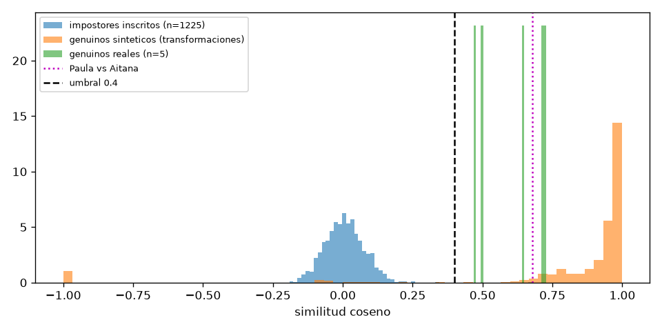

# Informe de evaluacion - CVLFace ViT-KPRPE

Personas inscritas: **50** | umbral verificacion = **0.4** | umbral identificacion = **0.4** (similitud coseno)

## 1. Distribucion de impostores (inscritos entre si)

1225 pares. media=0.007, p99=0.178, max=0.678, FAR al umbral = 0.0008

Pares de impostores mas parecidos:

| persona A | persona B | score |
|---|---|---|
| aitana_etxebarria_(twin_melody) | paula_etxeberria_(twin_melody) | 0.678 |
| salma_hayek | tini | 0.343 |
| keanu_reeves | temuera_morrison | 0.255 |
| anya_taylor_joy | keanu_reeves | 0.248 |
| arianna_grande | taylor_swift | 0.228 |
| jackie_chan | temuera_morrison | 0.220 |
| cynthia_erivo | winnie_harlow | 0.207 |
| christian_bale | eva_hache | 0.200 |

## 2. Pares genuinos sinteticos (foto de inscripcion transformada)

Cada foto de inscripcion se transforma y se verifica contra su propio template. Es una estimacion OPTIMISTA (misma foto de origen), pero mide la robustez a cada degradacion.

| transformacion | score medio | score min | TAR (verif.) | identif. correcta | sin cara detectada |
|---|---|---|---|---|---|
| original | 1.000 | 1.000 | 100% | 100% | 0 |
| espejo | 0.968 | -0.067 | 98% | 98% | 0 |
| rotacion 15 | 0.990 | 0.970 | 100% | 100% | 0 |
| rotacion 30 | 0.961 | -0.087 | 98% | 98% | 0 |
| rotacion 90 | 0.017 | -1.000 | 44% | 44% | 20 |
| baja res 200px | 0.937 | -1.000 | 98% | 98% | 1 |
| baja res 100px | 0.767 | -1.000 | 92% | 92% | 3 |
| desenfoque r=3 | 0.977 | 0.890 | 100% | 100% | 0 |
| oscura x0.4 | 0.991 | 0.971 | 100% | 100% | 0 |
| sobreexpuesta x1.8 | 0.899 | -0.092 | 98% | 98% | 0 |
| escala de grises | 0.944 | 0.873 | 100% | 100% | 0 |
| JPEG q=10 | 0.912 | -0.068 | 98% | 98% | 0 |
| ruido sigma=25 | 0.957 | 0.870 | 100% | 100% | 0 |
| gafas de sol | 0.740 | -0.085 | 98% | 98% | 0 |
| mascarilla | 0.749 | -0.085 | 98% | 98% | 0 |

## 3. Pares genuinos REALES (data/test)

5 genuinos, 245 impostores. TAR=100.0%, FAR=2.04% al umbral 0.4. EER=0.82% (umbral 0.44). Identificacion correcta (open-set) = 80.0%

Errores de identificacion:

| real | identificado | foto |
|---|---|---|
| aitana_etxebarria_(twin_melody) | paula_etxeberria_(twin_melody) | neo2_1_dcha.jpg |

## 5. Gemelas Twin Melody (Paula vs Aitana)

Similitud entre los templates de **paula_etxeberria_(twin_melody)** y **aitana_etxebarria_(twin_melody)**: **0.678** (SUPERA el umbral 0.4). Hay 0 pares de impostores con score mayor.

Fotos de prueba de cada gemela verificadas contra su id y contra el de su hermana:

| persona real | foto | score con su id | score con la hermana | aceptada como hermana | identificada como |
|---|---|---|---|---|---|
| paula_etxeberria_(twin_melody) | neo2_1_izda.jpg | 0.468 | 0.438 | SI | paula_etxeberria_(twin_melody) |
| paula_etxeberria_(twin_melody) | neo2_2_izda.jpg | 0.710 | 0.655 | SI | paula_etxeberria_(twin_melody) |
| aitana_etxebarria_(twin_melody) | formulatv.jpg | 0.727 | 0.646 | SI | aitana_etxebarria_(twin_melody) |
| aitana_etxebarria_(twin_melody) | neo2_1_dcha.jpg | 0.499 | 0.543 | SI | paula_etxeberria_(twin_melody) |
| aitana_etxebarria_(twin_melody) | neo2_2_dcha.jpg | 0.641 | 0.600 | SI | aitana_etxebarria_(twin_melody) |

FAR entre gemelas = **100%**: la gemela entra como su hermana en verificacion.

## 6. Ataques

### 6.1 Saltarse el detector (*_sd) con imagenes que no son caras

| entrada | con detector | sin detector: id top-1 | score | aceptado |
|---|---|---|---|---|
| ruido uniforme | rechazado (sin cara) | wiliem_dafoe | 0.090 | False |
| gris liso | rechazado (sin cara) | falete | 0.085 | False |
| negro | rechazado (sin cara) | hasbulla_magomedov | 0.084 | False |
| degradado | rechazado (sin cara) | wiliem_dafoe | 0.120 | False |

Fotos de inscripcion completas (sin recortar) por identificar_sd: 24/50 identificadas correctamente. El alineador DFA asume una cara centrada que ocupa la imagen; si la cara es pequena el resultado se degrada.

### 6.2 El atacante LEE la base de datos (replay de templates)

Reinyectando los templates robados con verificar_t/identificar_t: 50/50 verificaciones aceptadas, 50/50 identificaciones (score 1.0). Los templates en claro equivalen a credenciales: con verificar_t no hace falta ni la cara.

### 6.3 Ataque de hill-climbing usando el score de verificar_t como oraculo

El atacante NO lee la BD; solo consulta verificar_t(victima, template) y ve el score.

- adam_pearson: aceptado=True tras 256 consultas (score 0.401)
- adele: aceptado=True tras 270 consultas (score 0.402)
- aitana_etxebarria_(twin_melody): aceptado=True tras 301 consultas (score 0.403)
- anya_taylor_joy: aceptado=True tras 229 consultas (score 0.401)
- arianna_grande: aceptado=True tras 316 consultas (score 0.404)

### 6.4 Template 'maestro' (media de todos los templates de la BD)

Score maximo contra la BD = 0.331; aceptado por 0 identidades.

### 6.5 El atacante ESCRIBE en la base de datos

Victima: adam_pearson. El atacante anade una fila con SU template bajo el id de la victima.
- SIN firma HMAC: atacante aceptado como victima = **True** (score 1.000); filas descartadas al cargar = 0
- CON firma HMAC: atacante aceptado como victima = **False** (score -0.000); filas descartadas al cargar = 1
La firma HMAC solo protege si la clave NO esta al alcance del atacante (p.ej. variable de entorno del servidor, no en el repositorio). Si puede borrar filas sigue siendo posible una denegacion de servicio, y si conoce la clave el ataque funciona igual.

### 6.6 Templates malformados

- NaN: rechazado: ValueError: El template contiene NaN/Inf
- longitud 128: rechazado: ValueError: El template debe tener 512 valores (tiene 128)
- vector nulo: rechazado: ValueError: El template es (casi) nulo
- texto: rechazado: ValueError: could not convert string to float: 'hola'

### 6.7 Enumeracion de identidades

verificar_t con un id inexistente devuelve score=None (None) mientras que con un id existente devuelve un numero: se puede averiguar quien esta inscrito.

